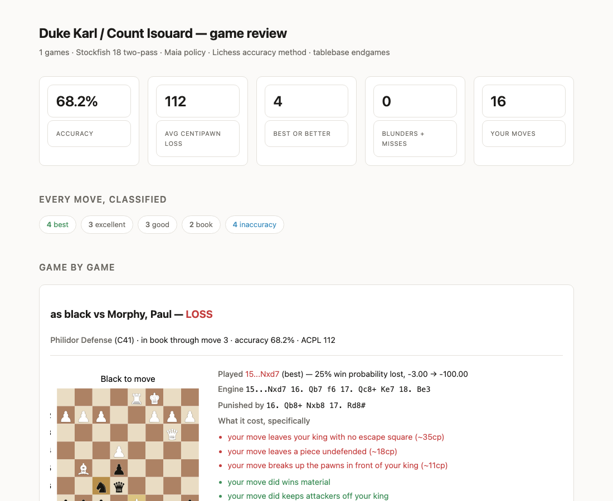

# Chess training toolkit

I made these to find out which kinds of mistakes really cost me games, not just where the engine says I went wrong. The tools pull your games from chess.com or lichess, run them through Stockfish, compare each of your moves with what players at your rating usually play (the Maia networks), and turn the moves that cost you the most into drill cards.

Everything is plain Python scripts in one folder. There is no install step beyond the two dependencies and Stockfish.

## What you need

- Python 3.10 or newer. `pip install -r requirements.txt` installs python-chess and requests.
- Stockfish on your PATH. On a Mac: `brew install stockfish`. On Debian or Ubuntu: `apt install stockfish`. Or get it from stockfishchess.org.
- For the "what would a player at your level do" part, which is optional: lc0 (`brew install lc0`, or lczero.org) and the Maia networks. Download `maia-1100.pb.gz`, `maia-1300.pb.gz`, `maia-1500.pb.gz`, `maia-1700.pb.gz` and `maia-1900.pb.gz` from the `maia_weights` folder of github.com/CSSLab/maia-chess into `engines/maia/`, or set `MAIA_WEIGHTS` to the folder that holds them. Without them the tools still run. review.py prints "(no Maia: ...)" and skips that part, and coach.py takes `--no-maia`.

## Try it on the example game first

The example is Morphy's Opera Game from 1858. These commands are the ones I ran before publishing, so they work on a fresh clone with just Stockfish.

```
python3 selftest.py                      # no engine, no network, under a second
python3 review.py examples/opera-game.pgn --me "Duke Karl / Count Isouard" --rating 1500 --out reports/review.json
python3 report2.py reports/review.json "Duke Karl / Count Isouard" reports/review.html
python3 drill.py                         # builds drill cards from reports/review*.json and shows the first one
python3 analyze.py examples/opera-game.pgn --max-games 1
```

The review report for the example game looks like this:



## Your own games

```
python3 fetch.py YOUR_USERNAME --site chess.com -n 20 --time-class rapid   # saves a PGN under games/
python3 coach.py YOUR_USERNAME --rating 1500 -n 20 -k 5                      # fetch, screen, deep pass, cross-game diagnosis -> reports/
python3 review.py games/THE_FILE.pgn --me YOUR_USERNAME --rating 1500 --out reports/review.json
python3 report2.py reports/review.json YOUR_USERNAME reports/review.html
python3 drill.py                                                              # run it again whenever cards are due
python3 loss.py YOUR_USERNAME                                                 # the decisive moment in each game you lost
python3 rating_estimate.py games/THE_FILE.pgn --me YOUR_USERNAME             # strength estimate from the Maia networks
```

Use `--site lichess` for lichess accounts. The chess.com and lichess APIs are public and need no login.

## What each file does

| File | What it does |
|---|---|
| coach.py | The whole pipeline. Fetches your games, screens them at low depth, analyzes the worst ones deeply, and says which kind of error costs you the most and whether players at your rating usually avoid it. |
| fetch.py | Pulls games from chess.com or lichess into a PGN file. |
| analyze.py | Annotates one PGN with Stockfish and writes an HTML report. `--leela` adds a second opinion from lc0. |
| review.py | The second-generation review. Per move: the drop in win chance, a label, what Maia expected, and what the error actually costs you in points (playout.py). Writes JSON. |
| report2.py | Turns review.py's JSON into an HTML report with boards. |
| deep_game.py | Every notable moment in one game, with opening departure and the clock curve. |
| loss.py | Finds the decisive moment in each game you lost. |
| drill.py | Spaced repetition over the positions you got wrong, worst value first. |
| rating_estimate.py | Estimates your strength two independent ways from your moves, using the Maia networks. |
| endgame.py | Exact endgame verdicts from the free lichess tablebase API (7 pieces or fewer). |
| book.py | Names the opening and finds where you left the book (lichess ECO database). |
| accuracy.py | Lichess's accuracy formula. |
| classify.py | Move labels (best, great, miss, blunder, brilliant and so on) with credit for good play, plus position difficulty. |
| tactics.py | Why a move was bad: what it hung, what it missed, what it walked into. |
| motifs.py | Tactical motif detection (forks, pins, discovered attacks, back rank, x-rays and more). Run it directly to check itself. |
| diagnose.py | Combines the error taxonomy and the motifs into one diagnosis for a move. |
| difficulty.py | How hard a position is for a player at a given rating. |
| brilliancy.py | Brilliant-move detection by comparing a deep and a shallow engine. |
| features.py | Positional features: pawn structure, king safety, mobility, outposts, loose pieces, space. |
| phases.py | Opening, middlegame, endgame boundaries, Lichess's definition. |
| pawn_structures.py | Names the pawn structure (Carlsbad, Maróczy bind, Stonewall and so on). Run it directly to check itself. |
| playout.py | Counterfactual playouts: what an error actually costs you, in points. |
| board_svg.py | Small board images for the reports. |
| maia.py | Runs lc0 with a Maia network and reads its move probabilities. |
| paths.py | Where files go (see below). |
| selftest.py, tests_known.py | Tests. See below. |

## Where the files go

Games, reports and engine weights live under one folder. By default it is this folder, so `games/`, `reports/` and `engines/` appear next to the scripts (they are ignored by git). Set `CHESS_HOME` to put them somewhere else.

## Tests

- `python3 selftest.py` needs no engine and no network. It imports every module and checks known answers on known positions.
- `python3 tests_known.py` needs Stockfish. It is an adversarial set: positions where the right label is known independently, so the classifier can be caught being wrong rather than just consistent with itself.
- `python3 motifs.py` and `python3 pawn_structures.py` run their own checks when you run them directly.

## What I left out

My own games, reports and notes. The experiments where I fit the accuracy formula to chess.com's published numbers (the fitted parameters are in `data/acc_params.json`, with a held-out error of 8.7 accuracy points). The engines and networks, which you download yourself.

## Credits and license

Built on python-chess. The opening data is the lichess chess-openings database (CC0). The pawn structure names and classifier are ported from lichessTools by Siderite Zackwehdex (MIT), and the phase divider from lichess-org/scalachess (MIT). The accuracy formula is the one Lichess published. Maia is by the CSSLab at the University of Toronto. See THIRD-PARTY.md.

This toolkit is licensed under the GPL-3.0, because python-chess is.
